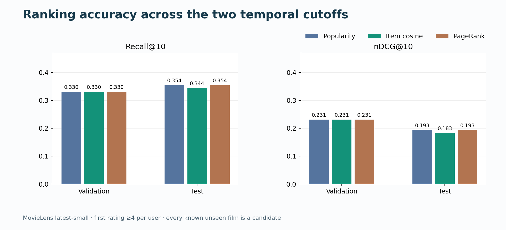
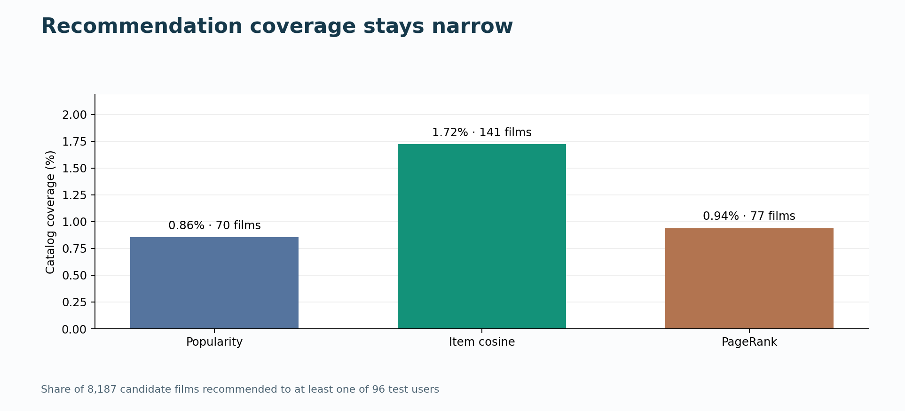
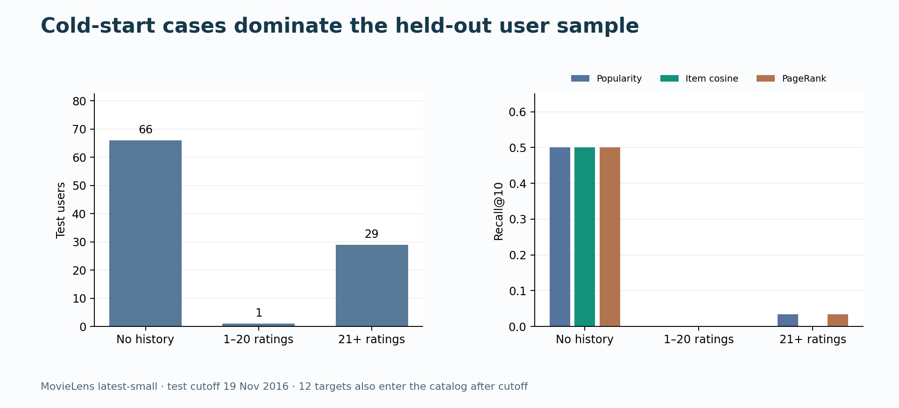

# Temporal Movie Graph Recommendation

Compare recency-weighted popularity, item cosine, and personalized PageRank when the catalog and user histories are frozen at two chronological cutoffs.

## Protocol

- The pinned MovieLens latest-small release contains 100,836 ratings and 9,742 movie records. The validation snapshot uses the 70th percentile timestamp, August 18, 2013 (UTC). The test snapshot uses the 85th percentile timestamp, November 19, 2016 (UTC). Only ratings strictly earlier than the applicable cutoff enter its graph or candidate catalog.
- Each evaluation user contributes the first rating of at least four stars in the evaluation interval. Ties at the same timestamp use the lowest movie ID. Every known film the user has never rated is a candidate. If a target film has no prior rating, it remains an unretrievable target in the overall results.
- Graph edges represent ratings of at least four stars for item cosine and PageRank. Popularity applies a one-year half-life to those ratings. PageRank uses 12 steps with a restart probability of 0.20. Users without positive history use the popularity ranking. Catalog coverage counts distinct films recommended at least once divided by the size of the frozen catalog.

## Results

The test snapshot contains 85,710 historical ratings and 8,187 candidate films. Among the 96 held-out users, 66 have no earlier ratings and 12 targets are absent from the frozen catalog.

| Method | Recall@10 | nDCG@10 | Catalog coverage |
| --- | ---: | ---: | ---: |
| Recency-weighted popularity | 0.354 | 0.193 | 0.86% |
| Item cosine | 0.344 | 0.183 | 1.72% |
| Personalized PageRank | 0.354 | 0.193 | 0.94% |

Popularity and PageRank each hit 34 targets. Their shared popularity fallback accounts for 33 hits on viewers with no history. The evaluation is a pilot on a pinned copy of latest-small. Its first-positive target measures offline ranking against observed ratings. It does not estimate viewing behavior or the effect of displaying recommendations.

## Neo4j and Redis verification

The Neo4j integration imports two distinct graphs using the dataset fingerprint and cutoff as the snapshot identity. It checks each graph against the benchmark's history, counts relationships at or after the cutoff, and repeats the test import to verify that the counts stay stable. The Redis key includes the snapshot identity, ranking method, viewer, and result limit. For each snapshot, the live check observes a miss followed by a hit and verifies that the Cypher popularity ranking returns the same ten films as the CPU implementation. The cosine and PageRank benchmarks use the sparse CPU graph.

[Ranking metrics](reports/metrics.json) · [Neo4j and Redis verification](reports/graph-verification.json) · [Local CPU timings](reports/latency.json)

## Reproduce

Set the local password as an environment variable for Neo4j. The compose profile binds both ports to loopback.

~~~powershell
python -m pip install -r requirements.txt
python -m unittest discover -s tests -v
python benchmark.py --out runs/moviebench
python plot_results.py
docker compose up -d --wait
python graph.py --out runs/graph-verification.json
docker compose down
~~~

The report contains only aggregate results. Ratings, movie metadata, and database volumes remain local under the GroupLens terms. [MovieLens release](https://grouplens.org/datasets/movielens/latest/) · [Dataset terms and attribution](https://files.grouplens.org/datasets/movielens/ml-latest-small-README.html)
